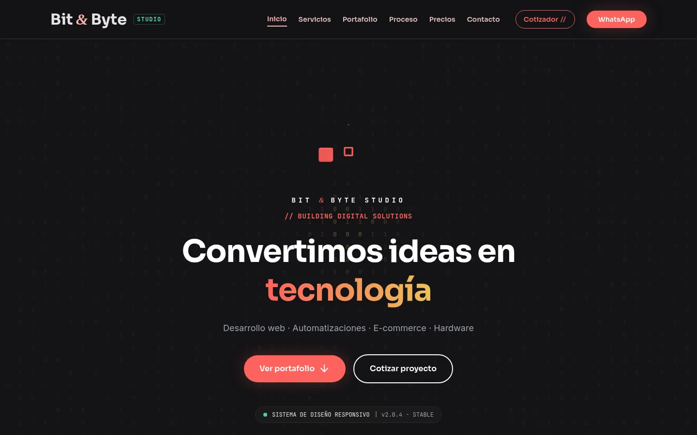
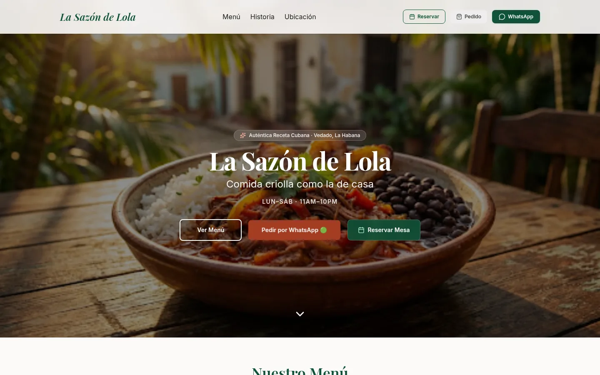
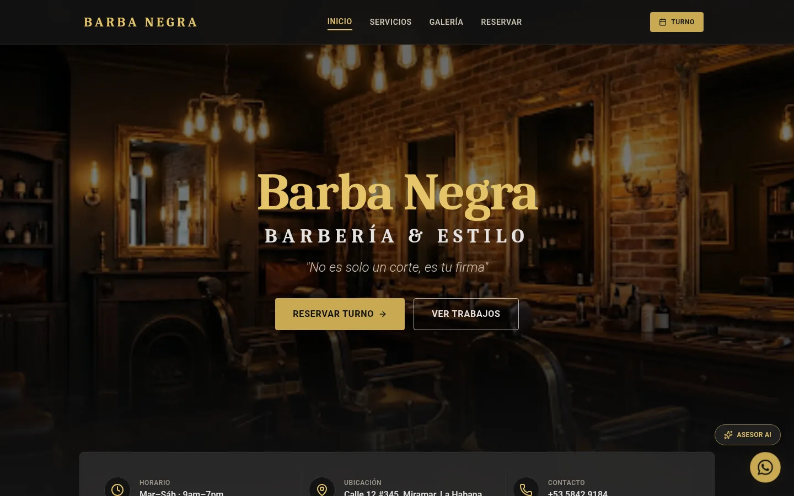
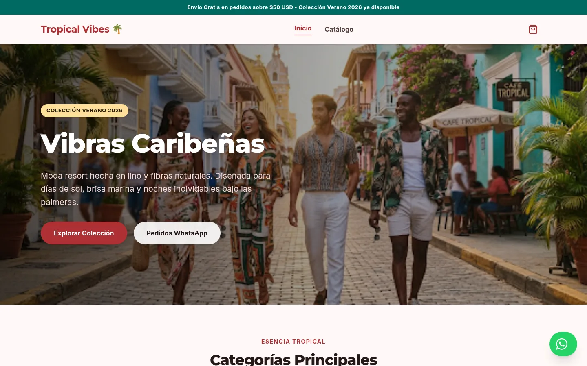

# Bit & Byte Studio

**Webs y software a medida para negocios en Cuba**

[Web](https://bitbytestudio.vercel.app) · [WhatsApp](https://wa.me/5350328131) · [Telegram](https://t.me/ItsJhonAlex) · [Email](mailto:itsjhonalex@gmail.com)

---

## Proyectos demo

<table>
  <tr>
    <td width="33%" valign="top">
      
      <h3>La Sazón de Lola</h3>
      
Web para restaurante de comida criolla: menú, reservas y pedidos por WhatsApp.

      <a href="https://sazon-lola.vercel.app">Demo en vivo</a> · <a href="https://github.com/bitbyte-studio/sazon-lola">Repo</a>
    </td>
    <td width="33%" valign="top">
      
      <h3>Barba Negra</h3>
      
Web para barbería: servicios, galería de trabajos y reserva de turnos.

      <a href="https://barba-negra-one.vercel.app">Demo en vivo</a> · <a href="https://github.com/bitbyte-studio/barba-negra">Repo</a>
    </td>
    <td width="33%" valign="top">
      
      <h3>Tropical Vibes</h3>
      
Tienda online de moda con catálogo, carrito y pedidos por WhatsApp.

      <a href="https://tropical-vibes.vercel.app">Demo en vivo</a> · <a href="https://github.com/bitbyte-studio/tropical-vibes">Repo</a>
    </td>
  </tr>
</table>

---

## Servicios

| Servicio | Qué incluye |
|---|---|
| **Landing pages** | Una página clara y rápida para presentar tu negocio o producto. |
| **Webs para restaurantes y negocios** | Menú, servicios, galería, ubicación y contacto directo por WhatsApp. |
| **Menús digitales** | Carta con QR, online o 100 % local sin internet para restaurantes (en uso real en Avanzar In Time). |
| **Tiendas online** | Catálogo de productos y pedidos desde el móvil. |

---

## Contacto

- **WhatsApp / Telegram:** +53 5032 8131 — [wa.me/5350328131](https://wa.me/5350328131) · [t.me/ItsJhonAlex](https://t.me/ItsJhonAlex)
- **Email:** [itsjhonalex@gmail.com](mailto:itsjhonalex@gmail.com)
- **Web:** [bitbytestudio.vercel.app](https://bitbytestudio.vercel.app)
